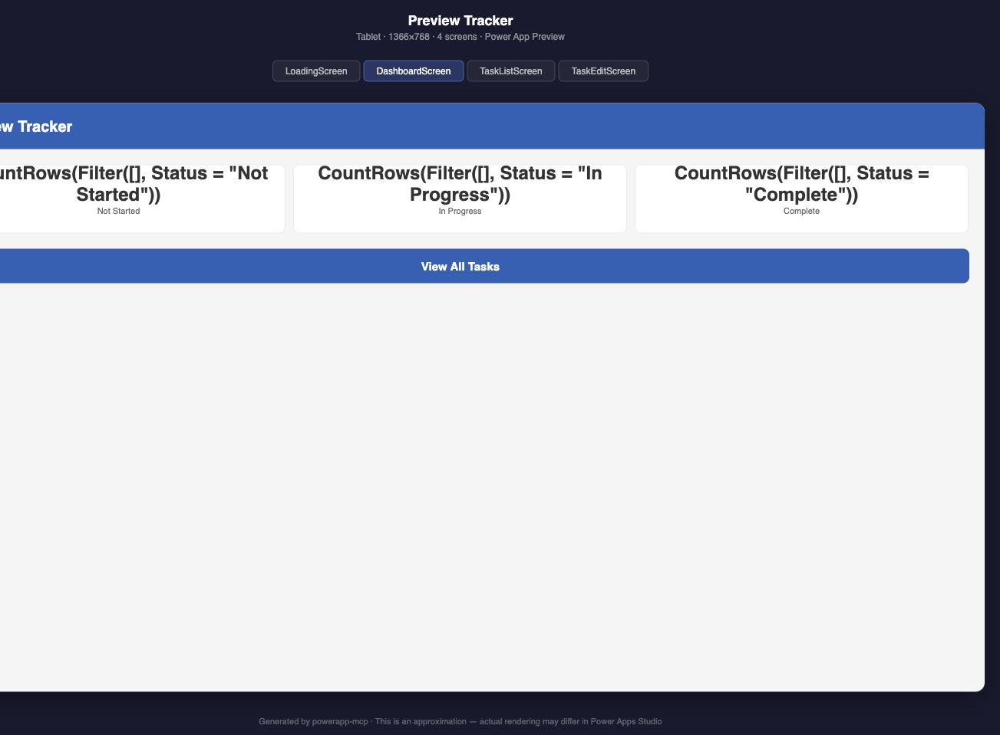

# powerapp-mcp

An MCP server that generates **Power Apps `.msapp` files from natural language**. Describe the
app in Claude Code — screens, controls, data sources, theme — and get back a real `.msapp` you
can import straight into Power Apps Studio, plus an interactive HTML preview before you commit.



## How it works

```
Claude Code ──stdio──▶ FastMCP server (17 tools, stateful AppState)
                            │
              Pydantic AppState (screens · controls · rules · data sources · theme)
                            │
              compiler: AppState → JSON files → ZIP → .msapp  (+ HTML preview)
```

The server is **stateful within a session**: tools mutate a single in-memory `AppState`
(add a screen, drop in a pre-built pattern, bind a data source, set the theme), and
`build_msapp` compiles the current state into a valid `.msapp` — correct `Header.json`,
`Properties.json` with 90 production-aligned feature flags, per-screen control trees,
`References/`, and `C8_`+SHA-256 checksums.

## What's inside

- **40+ control types** with sensible defaults, backed by an OAX XML template registry
  (30 types, extracted from Microsoft's published Teams sample templates)
- **Screen patterns**: loading, list, detail, form, settings — composed rather than hand-built
- **App templates**: list-detail, inspection, directory, tracker — a full working app in one call
- **Theming**: semantic color tokens (`gblAppStyles`) with light/dark palettes
- **HTML preview renderer** — see an approximation of every screen before opening Studio
- **Pre-build validation** — catches broken parent/child relationships and missing bindings
  before they become an un-importable ZIP

## The knowledge base

`knowledge/` is ~150KB of Power Apps format documentation assembled for this project —
the `.msapp` ZIP schema, all 60+ controls and their properties, 200+ Power Fx functions,
delegation rules, AI features, and a JSON Schema for the control structures. If you're
building anything that reads or writes `.msapp` files, it's a reference in its own right —
start with [`knowledge/MSAPP_SCHEMA_REFERENCE.md`](knowledge/MSAPP_SCHEMA_REFERENCE.md).

## Setup

```bash
pip install -e ".[dev]"
```

Register in Claude Code (`mcp.json` shows the shape):

```json
{
  "mcpServers": {
    "powerapp": {
      "command": "/path/to/powerapp-mcp/.venv/bin/python3",
      "args": ["-m", "powerapp_mcp.server"],
      "cwd": "/path/to/powerapp-mcp/src"
    }
  }
}
```

Then, in a session: *"Build me a phone app for tracking site inspections — loading screen,
inspection list with search, a detail screen, and a form. Dark theme."* → `build_msapp` →
import the file into Power Apps Studio.

## Tests

```bash
pytest
```

## Caveats

- Generated apps target the classic `.msapp` format; Power Apps Studio imports them, but
  Microsoft evolves the format — the pinned feature flags track production apps as of this
  writing.
- The HTML preview is an approximation (it renders Power Fx expressions as text rather than
  evaluating them); Studio is the source of truth.

## License

MIT
